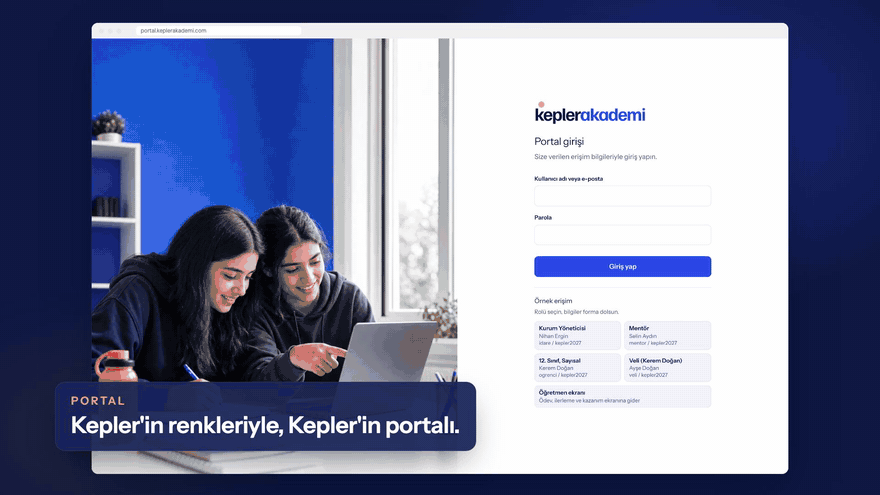
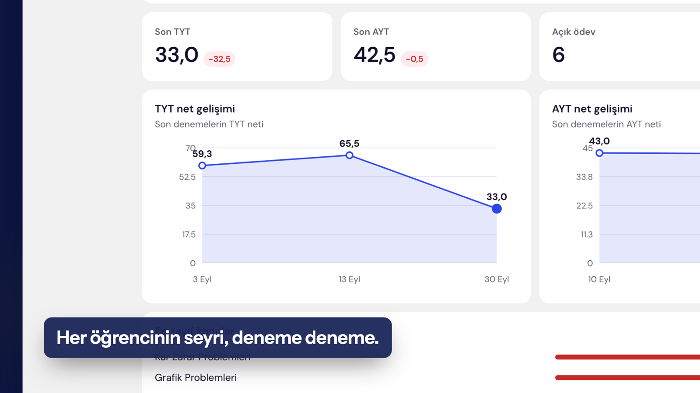
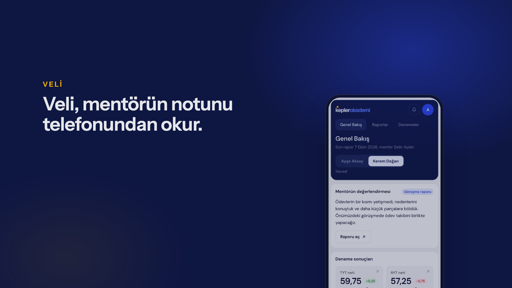
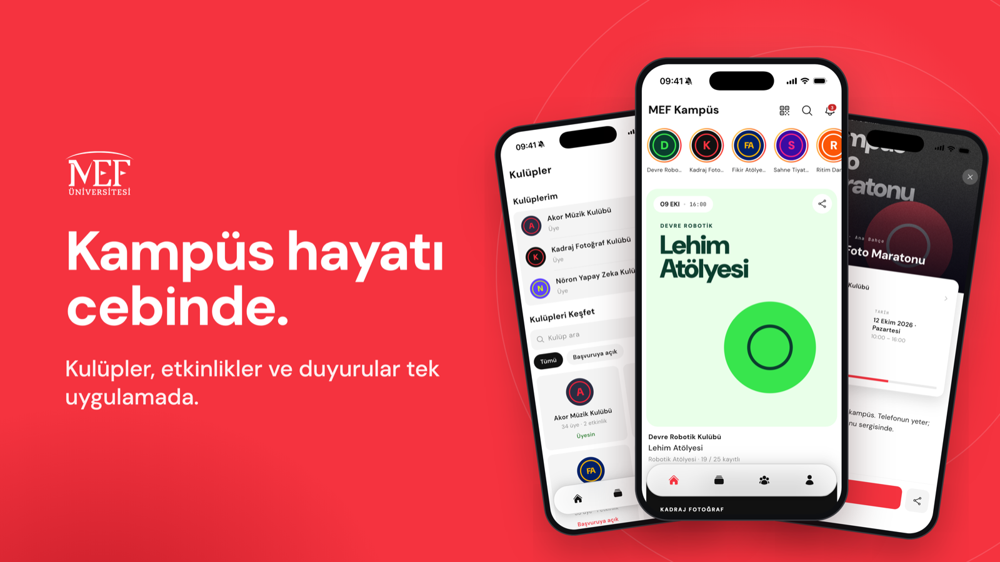

# Efe Müderrisoğlu

I build and ship multi-tenant SaaS products end to end: data model, API, web and mobile UI, deployment.

**Python · FastAPI · SvelteKit · Flutter · MySQL · Redis · Docker**

[cardeacore.com](https://cardeacore.com) · efe@cardeacore.com

> The code for the projects below is commercial and lives in private repositories. I can walk through the architecture and the code live in an interview.

---

## Case study: Kepler Akademi on Cardea Learn

- **Client:** Kepler Akademi, an online mentoring institution that prepares students for the YKS (Turkey's university entrance exam).
- **Live demo:** [cardeacore.com/kepler](https://cardeacore.com/kepler), running on the production stack with sample data (access on request)
- **Timeline:** First commit on 11 September 2026, deployed on 23 September 2026.

### The problem

Every student at Kepler has a one-to-one mentor. The mentor runs sessions, assigns homework, tracks mock exam results and reports to the parent. All of this lived in WhatsApp, spreadsheets and memory. Mentors could not see at a glance which student was slipping. Parents got updates when someone remembered to send them. Management had no view across mentors.

### What I built

One system with four role-based views on top of the same data:

| Role | What they get |
|---|---|
| **Mentor** | A "today" screen: next session with a one-click start, the students most at risk (net score drop, missing report, open homework), weekly calendar. Session mode that ends in a structured report. |
| **Student** | This week's plan, homework, mock exam entry, net score history. |
| **Parent** | Only their own child's reports and results. What a parent can see is decided by the institution's visibility policy, and hidden fields never leave the server. |
| **Management** | An overview with five headline numbers and a list of mentors who need attention. |

  

  
  

### Decisions worth mentioning

- **Built for the second customer, not just the first.** Branding, enabled modules and visibility rules come from an `institutions` row, not from code. A second institution starts on the same codebase with a new row. The same product now also runs a classroom-based prep school (branches, timetables, attendance, optical-reader exam import), with screens switched on per institution through module gates enforced in the backend.
- **One data gateway in the frontend.** Every screen reads data through a single API layer that can run against the real backend or an in-browser mock. Sales demos and UI work never depend on a running server.
- **Safe deployment next to another customer.** Kepler runs on the same server as a university's production install. It was added with its own Docker stack and two reverse-proxy routes, without touching the existing containers. The deploy script checks five live URLs before and after every release and stops if anything changes.
- **Operations from day one.** Migrations run on container start, nightly database backups with 14-day retention, a documented rollback path that handles schema downgrades in the right order.

### Stack

FastAPI · SQLAlchemy 2 (async) · Alembic · MySQL · Redis · JWT auth · SvelteKit 2 / Svelte 5 · TypeScript · Vitest · pytest · Docker · Caddy

### My role

Sole developer. Product scoping with the client, data model, backend, frontend, deployment and the marketing site. Around 700 commits, 65 migrations, 100+ backend and 290+ frontend test files.

---

## Cardea Campus (CampusCore)

**In production at MEF University.**

Student engagement platform for universities: clubs, events, approvals, QR check-in and the dean's office in one place.

### The problem

Club announcements got lost in WhatsApp groups. Event approvals ran through Google Forms and spreadsheets. Static QR codes for attendance were screenshotted and shared. The dean's office could not measure engagement.

### What I built

- **Event lifecycle** as an 11-state machine with two-stage approval (dean pre-approval, then final), venue allocation and co-hosted events.
- **Check-in** with QR, a 6-digit rotating code and NFC, so attendance codes cannot be forwarded.
- **Club workspace** gated by granular permissions: event wizard, tasks, documents, sponsors CRM, budget, inventory.
- **Administrative units** (career center, library and so on) with their own pages, content feed and ticket desk.
- **Multi-tenant and white-labelled.** One build serves several institutions; each tenant's branding is resolved from the hostname.
- **Web app plus a Flutter mobile app** on the same API.

### Architecture highlights

- Magic-link login (email OTP, domain restricted) for students, password login for staff, single-use refresh tokens with rotation and revocation.
- Two permission catalogues (15 club keys, 14 unit keys) as a single source of truth. The frontend renders them directly, so a new permission needs no frontend change.
- Row-level tenant isolation. Cross-tenant access returns 404 instead of leaking that a record exists.
- An MCP server that exposes dean and reporting tools to AI assistants over OAuth.

### Scale

125 models, 87 migrations, 55 API routers, 269 backend and 103 frontend test files, 3,000+ commits.

### Stack

FastAPI · SQLAlchemy 2 (async) · MySQL 8 · Redis · APScheduler · SvelteKit / Svelte 5 · Tailwind 4 · Flutter · Riverpod · Docker Compose · Caddy · Hetzner · Google Calendar · LTI 1.3

### My role

Founder and lead developer. Architecture, backend, web and mobile frontends, infrastructure and the relationship with the university.

---

## Working with me

I take a product from a vague problem to a deployed system and keep it running. If you have a project in this space (education, internal tools, multi-tenant SaaS, dashboards), email me at efe@cardeacore.com.
